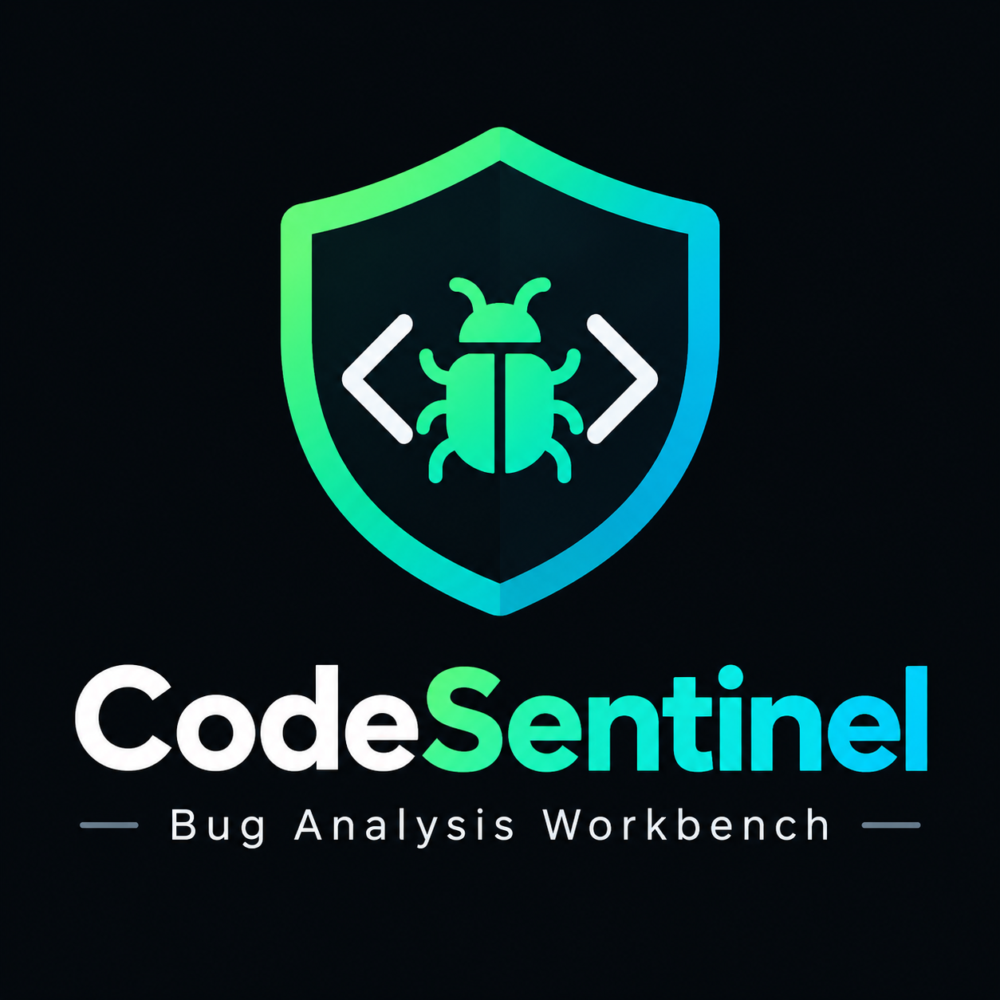

<p align="center">
  
</p>

# 🛡️ CodeSentinel - Code Quality Workbench

CodeSentinel is a modern desktop application for scanning Python projects, finding code quality problems, and producing professional reports. It helps developers review complexity, maintainability, duplication, security risks, and code smells from one polished workspace.

The app includes a redesigned dark UI with dashboard metrics, finding filters, file-level analysis, scan history, report previews, and configurable quality gates.

---

## ✨ Highlights

- 🧠 AST-based Python code analysis
- 🧪 Code smell detection
- 🔐 Security pattern checks
- 🔁 Duplicate code detection
- 📈 Cyclomatic, cognitive, and nesting complexity metrics
- 🧹 Maintainability scoring
- ⏱️ Technical debt estimation
- 📊 Dashboard with quality cards and charts
- 🚨 Priority findings panel
- 📁 File inventory with metric pills
- 🕒 Scan history tracking
- 📄 HTML, PDF, JSON, and CSV report generation
- ✅ Release gate support for CI/CD
- 🎨 Custom dark CodeSentinel UI with icons

---

## 🖥️ UI Sections

### 📊 Dashboard

The dashboard gives a fast overview of the latest scan:

- Quality Score
- Complexity Score
- Security Score
- Maintainability Score
- Findings by severity
- Overall grade progress
- Technical debt estimate
- Priority findings

### 🚨 Findings

The Findings page helps you inspect issues detected during analysis:

- Search findings
- Filter by severity
- Filter by issue type
- View file, line number, message, and recommendation
- Open finding details
- View code context area
- Generate fix suggestions placeholder

### 📁 File Inventory

The File Inventory page shows per-file metrics:

- File path
- Language
- Lines of code
- Complexity
- Maintainability
- Issue count

Long paths are shortened in the table, while the full path remains available in tooltips.

### 🕒 Scan History

The Scan History page tracks previous analysis runs:

- Quality trend data
- Security score
- Complexity score
- Maintainability score
- Duplication score
- Technical debt
- Grade

### 📄 Evidence Reports

The Reports page provides a polished report workflow:

- HTML/PDF format toggle
- Report content checkboxes
- Live report preview
- Report details card
- Generate report button
- Open report, show in folder, and share/copy path actions

### ⚙️ Control Room

The Settings page includes configurable analysis values:

- Code smell thresholds
- Scoring weights
- Release gate threshold

---

## 🧰 Tech Stack

- 🐍 Python 3.10+
- 🪟 PySide6 for the desktop UI
- 📊 Matplotlib for charts
- 🌳 Tree-sitter parser packages
- 🧾 Jinja2 and WeasyPrint for reporting
- 🗃️ SQLite for local scan history
- 🔧 GitPython for repository metadata

---

## 📦 Installation

Create and activate a virtual environment:

```bash
python -m venv .venv
```

On Windows PowerShell:

```powershell
.\.venv\Scripts\Activate.ps1
```

Install dependencies:

```bash
pip install -r requirements.txt
```

If your machine has certificate issues with PyPI, use:

```bash
pip install --trusted-host pypi.org --trusted-host files.pythonhosted.org -r requirements.txt
```

---

## 🚀 Run The Desktop App

From the project root:

```bash
python -m app.main
```

If you are using the local virtual environment directly on Windows:

```powershell
.\.venv\Scripts\python.exe -m app.main
```

---

## 🧑‍💻 CLI Usage

Analyze a project:

```bash
python -m cli.cli analyze /path/to/project
```

Analyze and export a report:

```bash
python -m cli.cli analyze /path/to/project --output report.html
```

Run a release gate:

```bash
python -m cli.cli gate /path/to/project --threshold 70
```

When installed as a package, the CLI entry point is:

```bash
codesentinel
```

---

## ✅ Release Gate

The release gate checks whether the project quality score meets a minimum threshold.

Example:

```bash
python -m cli.cli gate . --threshold 70
```

Result examples:

```text
Release Gate PASSED (Score: 82.5 >= 70)
```

```text
Release Gate FAILED (Score: 58.0 < 70)
```

---

## 🤖 GitHub Action

CodeSentinel includes a local composite GitHub Action:

```yaml
name: Code Quality

on: [push, pull_request]

jobs:
  quality:
    runs-on: ubuntu-latest
    steps:
      - uses: actions/checkout@v3
      - name: Run CodeSentinel
        uses: ./.github/actions/codesentinel
        with:
          threshold: 70
```

The action installs project requirements and runs:

```bash
python -m cli.cli gate ${{ inputs.path }} --threshold ${{ inputs.threshold }}
```

---

## 📄 Report Formats

CodeSentinel can generate:

- 🌐 HTML reports
- 🧾 PDF reports
- 🧱 JSON reports
- 📋 CSV reports

Default report filename:

```text
codesentinel_report.html
```

PDF export requires WeasyPrint and its platform dependencies.

---

## 🗃️ Local Data

Scan history is stored locally in SQLite:

```text
~/.codesentinel/codesentinel.db
```

This database stores:

- Projects
- Analysis runs
- File metrics
- Findings
- Duplicate code records

---

## 📂 Project Structure

```text
.
├── app/
│   ├── ai/                  # AI helper client placeholder
│   ├── core/
│   │   ├── analyzer/         # Complexity, smells, security, scoring, debt
│   │   ├── models/           # Dataclasses for project, file, issue, run
│   │   └── parsers/          # Python and Tree-sitter parser layers
│   ├── database/             # SQLite manager and repository
│   ├── git/                  # Git integration helpers
│   ├── reports/              # HTML/PDF/JSON/CSV generation
│   ├── services/             # Project and analysis orchestration
│   └── ui/                   # PySide6 desktop interface
├── cli/                      # Command-line interface
├── tests/                    # Unit tests
├── .github/                  # Workflow and CodeSentinel action
├── requirements.txt
└── pyproject.toml
```

---

## 🧪 Run Tests

Install pytest if needed:

```bash
pip install pytest
```

Run the test suite:

```bash
python -m pytest
```

Current verification target:

```text
22 tests passing
```

---

## 🔎 What CodeSentinel Detects

### 🧪 Code Smells

- Long methods
- Large classes
- Too many parameters
- Deep nesting
- Too many local variables

### 📈 Complexity

- Cyclomatic complexity
- Cognitive complexity
- Nesting depth

### 🔐 Security

- Hardcoded secrets
- Dangerous functions
- Weak cryptography patterns
- Risky execution calls

### 🔁 Duplication

- Similar or repeated code blocks
- Duplicate regions across files

---

## 🛠️ Troubleshooting

### PySide6 is missing

Install dependencies:

```bash
pip install -r requirements.txt
```

### PyPI SSL certificate error

Use trusted hosts:

```bash
pip install --trusted-host pypi.org --trusted-host files.pythonhosted.org -r requirements.txt
```

### PDF export fails

Make sure WeasyPrint is installed:

```bash
pip install weasyprint
```

Some systems also require native font/rendering libraries for PDF generation.

### No scan data appears

Run a project scan first:

```bash
python -m app.main
```

Then click **Scan Project** in the sidebar.

---

## 🧭 Development Notes

- UI theme tokens live in `app/ui/theme.py`
- Reusable UI widgets live in `app/ui/widgets/kit.py`
- Rendered line icons live in `app/ui/widgets/icons.py`
- Main desktop shell lives in `app/ui/main_window.py`
- Report UI lives in `app/ui/reports.py`
- Analyzer orchestration lives in `app/services/analysis_service.py`

---

## 🤝 Contributing

Contributions are welcome. A good contribution should:

- Keep analyzer behavior covered by tests
- Preserve the CodeSentinel branding
- Match the existing UI theme and spacing
- Avoid unrelated refactors
- Include documentation updates when behavior changes

---

## 📜 License

MIT

---

## 💚 CodeSentinel

Better Code. Stronger Projects.
